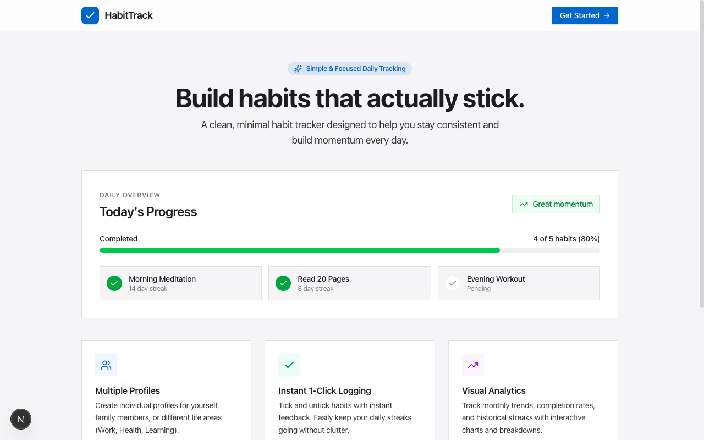
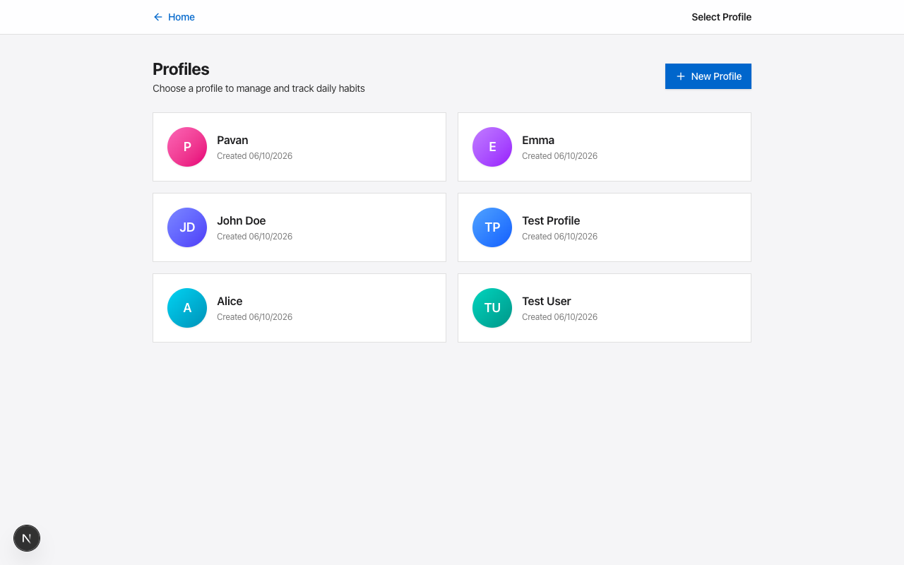
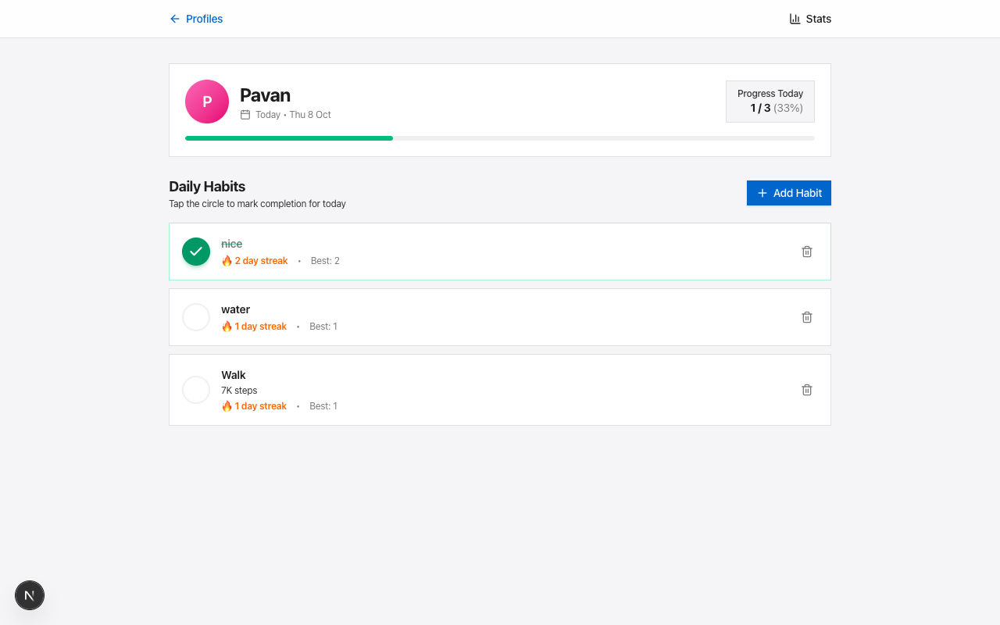
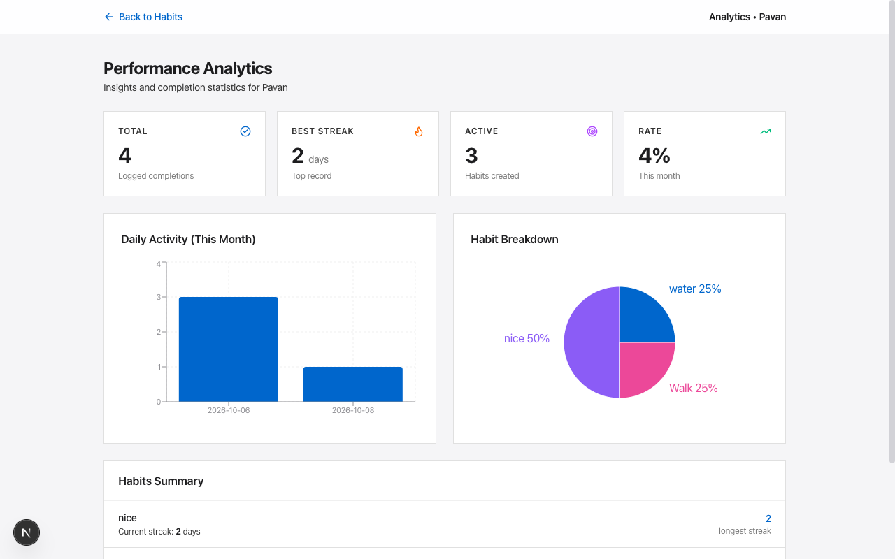

# HabitTrack

> A minimal, distraction-free habit tracker with multi-profile daily tracking, streaks, and visual analytics.



---

## ✨ Features

- 👤 **Multiple Profiles** — Create dedicated profiles for personal routines, work habits, fitness, or family members.
- ⚡ **Instant 1-Click Logging** — Optimized UI with spring animations and background sync for zero-lag habit completion.
- 🔥 **Streak & Momentum Tracking** — Real-time tracking of current and longest consecutive daily streaks.
- 📊 **Visual Performance Analytics** — Interactive monthly activity bar charts and habit completion breakdowns powered by Recharts.
- 🎨 **Clean Apple-Inspired UI** — Carefully balanced typography, subtle shadows, responsive layouts, and fluid Framer Motion transitions.
- 💾 **Reliable Local Storage** — Fast SQLite database engine with zero external database configuration required.

---

## 📸 Screenshots

| Landing Page | Profiles Selection |
| :---: | :---: |
|  |  |

| Habit Tracking Dashboard | Performance Analytics |
| :---: | :---: |
|  |  |

---

## 🛠 Tech Stack

- **Framework**: [Next.js 16 (App Router)](https://nextjs.org/) + React 19
- **Database**: [SQLite](https://sqlite.org/) via `better-sqlite3`
- **Styling**: [Tailwind CSS](https://tailwindcss.com/)
- **Animations**: [Framer Motion](https://www.framer.com/motion/)
- **Charts**: [Recharts](https://recharts.org/)
- **Icons**: [Lucide React](https://lucide.dev/)
- **Language**: TypeScript

---

## 🚀 Quickstart

### Prerequisites

- Node.js 18.x or higher
- npm, pnpm, or yarn

### Installation

1. **Clone the repository**:
   ```bash
   git clone https://github.com/pavan-sagar/HabitTrack.git
   cd HabitTrack
   ```

2. **Install dependencies**:
   ```bash
   npm install
   ```

3. **Start the local development server**:
   ```bash
   npm run dev
   ```

4. **Open in browser**:
   Navigate to [http://localhost:3000](http://localhost:3000)

---

## 📁 Project Structure

```text
habit-tracker-app/
├── public/
│   └── screenshots/          # Application screenshot assets
├── src/
│   ├── app/
│   │   ├── api/
│   │   │   ├── analytics/    # Monthly stats & chart aggregation API
│   │   │   ├── habits/       # Habit CRUD endpoints
│   │   │   ├── logs/         # Habit completion toggle & date query API
│   │   │   └── profiles/     # Profile management endpoints
│   │   ├── profile/[id]/     # Daily habit tracker page with tick animations
│   │   ├── profiles/         # Profile selector & creation page
│   │   ├── stats/[id]/       # Visual performance analytics & streak breakdowns
│   │   ├── globals.css       # Tailwind CSS design system tokens
│   │   ├── layout.tsx        # Root layout wrapper
│   │   └── page.tsx          # Landing page
│   └── lib/
│       └── db.ts             # SQLite database layer & schema migrations
├── package.json
└── tsconfig.json
```

---

## 🔌 API Reference

| Method | Endpoint | Description |
| :--- | :--- | :--- |
| `GET` | `/api/profiles` | List all profiles |
| `GET` | `/api/profiles?id={id}` | Get single profile by ID |
| `POST` | `/api/profiles` | Create a profile (`{ name }`) |
| `DELETE` | `/api/profiles` | Delete profile and all linked habits (`{ id }`) |
| `GET` | `/api/habits?profileId={id}` | List all habits for profile |
| `POST` | `/api/habits` | Create habit (`{ profileId, title, description }`) |
| `DELETE` | `/api/habits` | Delete habit (`{ id }`) |
| `GET` | `/api/logs?profileId={id}&date={YYYY-MM-DD}` | Get completions for date |
| `POST` | `/api/logs` | Toggle habit completion (`{ habitId, date }`) |
| `GET` | `/api/analytics?profileId={id}&year={YYYY}&month={MM}` | Get monthly metrics & charts |

---

## 📄 License

This project is licensed under the MIT License.
